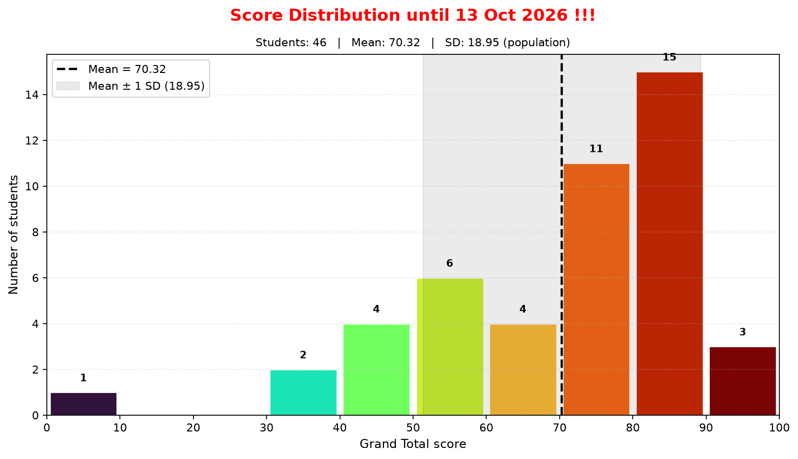

# Class Performance Summary

Exercise: 70% · Attendance: 30% · Exercise maximum: 128 · Attendance sessions: 8

**Grand Total statistics:** Students = 46 · Mean = 70.32 · SD = 18.95 (population)

## Score Distribution until 13 Oct 2026 !!!

| No. | Student ID | Name | Exercise | Exercise 70% | Attendance | Attendance 30% | Grand Total | Performance |
|---:|:---:|:---|---:|---:|:---:|---:|---:|:---:|
| 1 | 6610553157 | ---- | 50.00/128.00 | 27.34 | 5/8 | 18.75 | **46.09** | ★☆☆☆☆ |
| 2 | 6610553165 | ---- | 62.00/128.00 | 33.91 | 6/8 | 22.50 | **56.41** | ★☆☆☆☆ |
| 3 | 6610553173 | ---- | 50.00/128.00 | 27.34 | 4/8 | 15.00 | **42.34** | ★☆☆☆☆ |
| 4 | 6610553181 | ---- | 84.00/128.00 | 45.94 | 8/8 | 30.00 | **75.94** | ★★★☆☆ |
| 5 | 6610553203 | ---- | 61.00/128.00 | 33.36 | 7/8 | 26.25 | **59.61** | ★☆☆☆☆ |
| 6 | 6610553220 | ---- | 29.00/128.00 | 15.86 | 5/8 | 18.75 | **34.61** | ★☆☆☆☆ |
| 7 | 6610553238 | ---- | 56.00/128.00 | 30.62 | 6/8 | 22.50 | **53.12** | ★☆☆☆☆ |
| 8 | 6610553254 | ---- | 84.00/128.00 | 45.94 | 8/8 | 30.00 | **75.94** | ★★★☆☆ |
| 9 | 6610553262 | ---- | 68.00/128.00 | 37.19 | 7/8 | 26.25 | **63.44** | ★★☆☆☆ |
| 10 | 6610553271 | ---- | 90.00/128.00 | 49.22 | 8/8 | 30.00 | **79.22** | ★★★☆☆ |
| 11 | 6610553289 | ---- | 57.00/128.00 | 31.17 | 7/8 | 26.25 | **57.42** | ★☆☆☆☆ |
| 12 | 6610553327 | ---- | 34.00/128.00 | 18.59 | 5/8 | 18.75 | **37.34** | ★☆☆☆☆ |
| 13 | 6610554153 | ---- | 64.00/128.00 | 35.00 | 6/8 | 22.50 | **57.50** | ★☆☆☆☆ |
| 14 | 6610554161 | ---- | 54.00/128.00 | 29.53 | 3/8 | 11.25 | **40.78** | ★☆☆☆☆ |
| 15 | 6710552942 | ---- | 82.00/128.00 | 44.84 | 7/8 | 26.25 | **71.09** | ★★★☆☆ |
| 16 | 6710552951 | ---- | 101.00/128.00 | 55.23 | 8/8 | 30.00 | **85.23** | ★★★★☆ |
| 17 | 6710552969 | ---- | 100.00/128.00 | 54.69 | 8/8 | 30.00 | **84.69** | ★★★★☆ |
| 18 | 6710552977 | ---- | 74.00/128.00 | 40.47 | 8/8 | 30.00 | **70.47** | ★★★☆☆ |
| 19 | 6710552985 | ---- | 94.00/128.00 | 51.41 | 8/8 | 30.00 | **81.41** | ★★★★☆ |
| 20 | 6710552993 | ---- | 81.00/128.00 | 44.30 | 7/8 | 26.25 | **70.55** | ★★★☆☆ |
| 21 | 6710553001 | ---- | 53.00/128.00 | 28.98 | 5/8 | 18.75 | **47.73** | ★☆☆☆☆ |
| 22 | 6710553027 | ---- | 93.00/128.00 | 50.86 | 8/8 | 30.00 | **80.86** | ★★★★☆ |
| 23 | 6710553035 | ---- | 101.00/128.00 | 55.23 | 8/8 | 30.00 | **85.23** | ★★★★☆ |
| 24 | 6710553051 | ---- | 0.00/128.00 | 0.00 | 0/8 | 0.00 | **0.00** | ★☆☆☆☆ |
| 25 | 6710553078 | ---- | 100.00/128.00 | 54.69 | 8/8 | 30.00 | **84.69** | ★★★★☆ |
| 26 | 6710553086 | ---- | 78.00/128.00 | 42.66 | 7/8 | 26.25 | **68.91** | ★★☆☆☆ |
| 27 | 6710553094 | ---- | 119.00/128.00 | 65.08 | 8/8 | 30.00 | **95.08** | ★★★★★ |
| 28 | 6710553108 | ---- | 98.00/128.00 | 53.59 | 8/8 | 30.00 | **83.59** | ★★★★☆ |
| 29 | 6710553124 | ---- | 98.00/128.00 | 53.59 | 7/8 | 26.25 | **79.84** | ★★★☆☆ |
| 30 | 6710553141 | ---- | 98.00/128.00 | 53.59 | 8/8 | 30.00 | **83.59** | ★★★★☆ |
| 31 | 6710553167 | ---- | 76.00/128.00 | 41.56 | 7/8 | 26.25 | **67.81** | ★★☆☆☆ |
| 32 | 6710553191 | ---- | 124.00/128.00 | 67.81 | 8/8 | 30.00 | **97.81** | ★★★★★ |
| 33 | 6710553205 | ---- | 104.00/128.00 | 56.88 | 7/8 | 26.25 | **83.12** | ★★★★☆ |
| 34 | 6710553213 | ---- | 87.00/128.00 | 47.58 | 8/8 | 30.00 | **77.58** | ★★★☆☆ |
| 35 | 6710553264 | ---- | 62.00/128.00 | 33.91 | 8/8 | 30.00 | **63.91** | ★★☆☆☆ |
| 36 | 6710553272 | ---- | 76.00/128.00 | 41.56 | 8/8 | 30.00 | **71.56** | ★★★☆☆ |
| 37 | 6710553281 | ---- | 88.00/128.00 | 48.12 | 8/8 | 30.00 | **78.12** | ★★★☆☆ |
| 38 | 6710553299 | ---- | 104.00/128.00 | 56.88 | 8/8 | 30.00 | **86.88** | ★★★★☆ |
| 39 | 6710553329 | ---- | 95.00/128.00 | 51.95 | 8/8 | 30.00 | **81.95** | ★★★★☆ |
| 40 | 6710553337 | ---- | 94.00/128.00 | 51.41 | 7/8 | 26.25 | **77.66** | ★★★☆☆ |
| 41 | 6710553345 | ---- | 100.00/128.00 | 54.69 | 8/8 | 30.00 | **84.69** | ★★★★☆ |
| 42 | 6710553353 | ---- | 101.00/128.00 | 55.23 | 8/8 | 30.00 | **85.23** | ★★★★☆ |
| 43 | 6710553361 | ---- | 103.00/128.00 | 56.33 | 8/8 | 30.00 | **86.33** | ★★★★☆ |
| 44 | 6710553370 | ---- | 52.00/128.00 | 28.44 | 8/8 | 30.00 | **58.44** | ★☆☆☆☆ |
| 45 | 6710553388 | ---- | 107.00/128.00 | 58.52 | 8/8 | 30.00 | **88.52** | ★★★★☆ |
| 46 | 6710553396 | ---- | 114.00/128.00 | 62.34 | 8/8 | 30.00 | **92.34** | ★★★★★ |

Performance rating: ★★★★★ ≥ 90, ★★★★☆ ≥ 80, ★★★☆☆ ≥ 70, ★★☆☆☆ ≥ 60, ★☆☆☆☆ &lt; 60.
